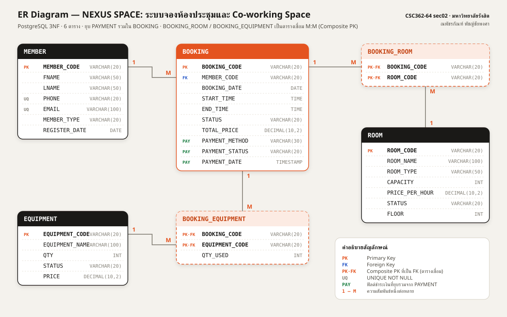
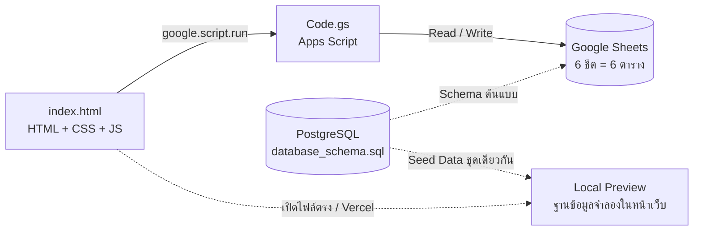

<div align="center">

# 🏢 NEXUS SPACE — Meeting Room & Co-working Booking System

### ระบบจองห้องประชุมและ Co-working Space

[](https://www.postgresql.org/)
[](https://developer.mozilla.org/en-US/docs/Web/JavaScript)
[](https://developer.mozilla.org/en-US/docs/Web/HTML)
[](https://developers.google.com/apps-script)
[](https://vercel.com/)

**ระบบจองห้องประชุมแบบครบวงจร ออกแบบฐานข้อมูล 6 ตารางตามหลัก 3NF บน PostgreSQL**

[🌐 Live Demo](https://nexus-space-six.vercel.app) · [🗂️ Database](docs/DATABASE.md) · [🎤 Demo Guide](docs/DEMO_GUIDE.md) · [📝 Changelog](CHANGELOG.md)

</div>

---

## ✨ ฟีเจอร์หลัก

| | ฟีเจอร์ | ตารางที่เกี่ยวข้อง |
|---|---|---|
| 📅 | **ตารางการใช้ห้องรายวัน (Timeline)** แสดงทุกห้อง × ทุกชั่วโมง เห็นช่วงที่ถูกจองทันที คลิกช่องว่างเพื่อเลือกห้อง/เวลา | `ROOM`, `BOOKING`, `BOOKING_ROOM` |
| 🧩 | **จองหลายห้องในบิลเดียว** (Many-to-Many) | `BOOKING_ROOM` |
| 🎛️ | **เลือกอุปกรณ์เสริมพร้อมจำนวน** ตรวจสต็อกคงเหลือในช่วงเวลาเดียวกัน | `EQUIPMENT`, `BOOKING_EQUIPMENT.QTY_USED` |
| 🔒 | **ป้องกันการจองซ้อนทับ** ทุกห้องที่เลือก + `CHECK (END_TIME > START_TIME)` + ห้ามจองย้อนหลัง | `BOOKING` |
| 👤 | **สมาชิกเดิม/ใหม่อัตโนมัติ** ใช้เบอร์โทรเดิม (`PHONE UNIQUE`) ตรวจอีเมลซ้ำ (`EMAIL UNIQUE`) สร้างรหัส `M005, M006, …` | `MEMBER` |
| 💰 | **คำนวณราคาอัตโนมัติ** `ชั่วโมง × Σ ราคาห้อง + Σ (ราคาอุปกรณ์ × จำนวน)` คำนวณซ้ำฝั่งเซิร์ฟเวอร์ | `BOOKING.TOTAL_PRICE` |
| 💳 | **ชำระเงินรวมในใบจอง** PromptPay/Credit Card = `Paid` ทันที, Bank Transfer/Cash = `Pending` | `BOOKING.PAYMENT_*` |
| 🎫 | **ใบยืนยันการจอง (Voucher)** พร้อมสถานะ พิมพ์ได้เฉพาะใบยืนยัน | — |
| 🔍 | **ค้นหาประวัติ** ด้วยเบอร์โทร / อีเมล / รหัสสมาชิก / เลขที่ใบจอง | `MEMBER` ⟶ `BOOKING` |
| 🛡️ | **หน้าผู้ดูแลระบบ** ปรับ `STATUS` และ `PAYMENT_STATUS` ได้ครบทุกค่าตาม CHECK constraint | `BOOKING` |
| 🗄️ | **หน้าพจนานุกรมข้อมูล** แสดงทุกคอลัมน์/ชนิดข้อมูล/Constraint/FK ตรงกับ SQL | ทั้ง 6 ตาราง |
| 🌙 | **โหมดสว่าง/มืด** และ **Responsive** ใช้งานได้ตั้งแต่มือถือถึงจอใหญ่ | — |

---

## 🗃️ ER Diagram

<div align="center">



</div>

### ความสัมพันธ์

| Parent | Child | Cardinality | Constraint | ON DELETE |
|---|---|---|---|---|
| `MEMBER` | `BOOKING` | 1 : M | `FK_BOOKING_MEMBER` | RESTRICT |
| `BOOKING` | `BOOKING_ROOM` | 1 : M | `FK_BR_BOOKING` | CASCADE |
| `ROOM` | `BOOKING_ROOM` | 1 : M | `FK_BR_ROOM` | RESTRICT |
| `BOOKING` | `BOOKING_EQUIPMENT` | 1 : M | `FK_BE_BOOKING` | CASCADE |
| `EQUIPMENT` | `BOOKING_EQUIPMENT` | 1 : M | `FK_BE_EQUIPMENT` | RESTRICT |

### จุดเด่นของการออกแบบ (ปรับตามคำแนะนำอาจารย์)

| Concept | คำอธิบาย |
|---|---|
| **Merged Payment** | ยุบตาราง `PAYMENT` รวมเข้า `BOOKING` (`PAYMENT_METHOD`, `PAYMENT_STATUS`, `PAYMENT_DATE`) ลดความสัมพันธ์ 1:1 ที่ไม่จำเป็น |
| **Multi-room (M:N)** | เพิ่ม `BOOKING_ROOM` เป็นตารางเชื่อม ให้ 1 ใบจองมีได้หลายห้อง |
| **Composite PK** | `BOOKING_ROOM (BOOKING_CODE, ROOM_CODE)` และ `BOOKING_EQUIPMENT (BOOKING_CODE, EQUIPMENT_CODE)` กันข้อมูลซ้ำในใบจองเดียว |
| **Historical price** | เก็บ `TOTAL_PRICE` ณ วันจอง ราคาไม่เปลี่ยนตามราคาห้องในอนาคต |

รายละเอียดทุกคอลัมน์ ตัวอย่าง SQL Query และเหตุผลด้าน Normalization: **[docs/DATABASE.md](docs/DATABASE.md)**

---

## 🏗️ Architecture



- **โหมด Local Preview** (เปิดไฟล์ตรงหรือ Vercel) — หน้าเว็บมีฐานข้อมูลจำลอง 6 ตารางพร้อม Seed Data ชุดเดียวกับ `database_schema.sql` และกฎตรวจสอบเหมือนเซิร์ฟเวอร์ทุกข้อ (ข้อมูลหายเมื่อรีเฟรช)
- **โหมด Apps Script** — ข้อมูลถาวรใน Google Sheets ผ่าน `Code.gs` (ชื่อฟังก์ชันและรูปแบบผลลัพธ์เหมือนกันทุกตัว)

---

## 🚀 Getting Started

### 1) เปิดในเครื่อง (ง่ายที่สุด)

```bash
git clone https://github.com/Novterss/nexus-space.git
cd nexus-space
npx serve .
```

หรือดับเบิลคลิก `index.html` ได้เลย ไม่ต้องติดตั้งอะไรเพิ่ม

### 2) Google Apps Script (ข้อมูลถาวร)

1. สร้าง Google Spreadsheet ใหม่ → **Extensions › Apps Script**
2. วางโค้ด `Code.gs` → เลือกฟังก์ชัน `initDatabase` แล้วกด **Run** (สร้าง 6 ชีตพร้อม Seed Data)
3. สร้างไฟล์ HTML ชื่อ `index` แล้ววางโค้ดจาก `index.html`
4. **Deploy › New deployment › Web app** → เปิดลิงก์ใช้งาน

### 3) PostgreSQL (Schema + Seed Data)

```bash
psql -U postgres -d your_database -f database_schema.sql
```

### 4) Deploy บน Vercel

```bash
npx vercel --prod
```

---

## 📁 Project Structure

```
nexus-space/
├── index.html            # Web application (UI + Local Preview DB)
├── Code.gs               # Google Apps Script backend (Google Sheets)
├── database_schema.sql   # PostgreSQL DDL + Seed Data (ต้นฉบับของ ERD)
├── er_diagram.svg        # ER Diagram
├── docs/
│   ├── DATABASE.md       # Data dictionary, ความสัมพันธ์, Normalization, ตัวอย่าง SQL
│   └── DEMO_GUIDE.md     # ลำดับการสาธิตสำหรับนำเสนอ + Test cases
├── CHANGELOG.md          # ประวัติการแก้ไข
├── vercel.json           # Vercel config
├── package.json          # Project metadata
└── LICENSE               # MIT License
```

---

## 📖 Seed Data

| # | Table | Rows | Description |
|---|---|---|---|
| 1 | `MEMBER` | 4 | สมาชิก (M001–M004) |
| 2 | `ROOM` | 5 | ห้องประชุม/พื้นที่ทำงาน (R101–R401) |
| 3 | `EQUIPMENT` | 4 | อุปกรณ์เสริม (EQ01–EQ04) |
| 4 | `BOOKING` | 3 | ใบจอง + ข้อมูลชำระเงิน |
| 5 | `BOOKING_ROOM` | 4 | ห้องในแต่ละใบจอง (BK20260902 จอง 2 ห้อง) |
| 6 | `BOOKING_EQUIPMENT` | 5 | อุปกรณ์ในแต่ละใบจอง |

| Room | Type | Capacity | Price/Hour | Floor |
|---|---|---|---|---|
| R101 Focus Pod A | Creative Pod | 2 | ฿120 | 1 |
| R102 Focus Pod B | Creative Pod | 2 | ฿120 | 1 |
| R201 Brainstorm Studio | Meeting Room | 6 | ฿250 | 2 |
| R301 Executive Boardroom | Boardroom | 14 | ฿500 | 3 |
| R401 Grand Innovation Hall | Event Hall | 40 | ฿1,200 | 4 |

| Equipment | Price/Use | Stock |
|---|---|---|
| EQ01 4K Laser Projector + จอโปรเจคเตอร์ | ฿150 | 5 |
| EQ02 Smart Interactive Whiteboard | ฿100 | 3 |
| EQ03 ชุดไมโครโฟนไร้สายและระบบเสียงประชุม | ฿120 | 4 |
| EQ04 กล้อง 360 องศาสำหรับ Hybrid Meeting | ฿80 | 3 |

---

## 🎓 Academic Information

| | Details |
|---|---|
| **Course** | CSC362-64 sec02 Database Systems |
| **Instructor** | อ.สุมนา เกษมสวัสดิ์ |
| **Institution** | มหาวิทยาลัยรังสิต (Rangsit University) |
| **Semester** | ภาคการศึกษาที่ 1/2569 |
| **DBMS** | PostgreSQL |

## 👨‍💻 Author

**นายณพัชรกัณฑ์ พัชญ์ชัยพงศา** (Naphatcharakan Phatchaiphongsa) · [GitHub](https://github.com/Novterss)

## 📄 License

MIT — see [LICENSE](LICENSE)
