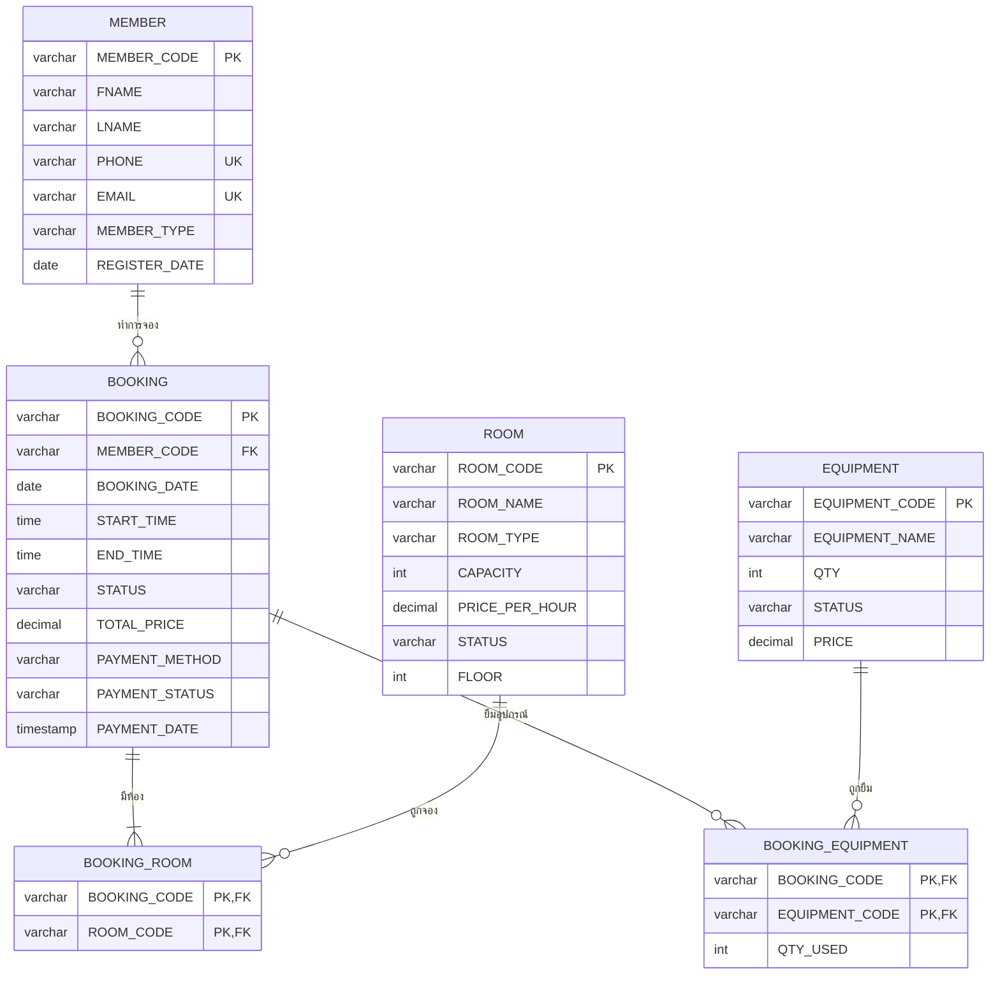

# 🗂️ Database Design — NEXUS SPACE

เอกสารออกแบบฐานข้อมูลของระบบจองห้องประชุมและ Co-working Space
ต้นฉบับ DDL และ Seed Data อยู่ที่ [`database_schema.sql`](../database_schema.sql) · แผนภาพอยู่ที่ [`er_diagram.svg`](../er_diagram.svg)

- **DBMS:** PostgreSQL
- **จำนวนตาราง:** 6 ตาราง (Master 3 · Transaction 1 · Junction 2)
- **ระดับ Normalization:** 3NF

---

## 1. ภาพรวมความสัมพันธ์



> ความสัมพันธ์ Many-to-Many สองคู่ (BOOKING ↔ ROOM, BOOKING ↔ EQUIPMENT) ถูกแตกเป็น 1:M สองเส้นผ่านตารางเชื่อม

---

## 2. Data Dictionary

### 2.1 `MEMBER` — ข้อมูลสมาชิก

| Column | Type | Key | Constraint |
|---|---|---|---|
| MEMBER_CODE | VARCHAR(20) | PK | เช่น `M001` |
| FNAME | VARCHAR(50) | | NOT NULL |
| LNAME | VARCHAR(50) | | NOT NULL |
| PHONE | VARCHAR(20) | UQ | UNIQUE NOT NULL |
| EMAIL | VARCHAR(100) | UQ | UNIQUE NOT NULL |
| MEMBER_TYPE | VARCHAR(20) | | DEFAULT `'General'`, CHECK IN (`General`, `VIP`, `Student`) |
| REGISTER_DATE | DATE | | DEFAULT `CURRENT_DATE` |

### 2.2 `ROOM` — ห้องประชุม / พื้นที่ทำงาน

| Column | Type | Key | Constraint |
|---|---|---|---|
| ROOM_CODE | VARCHAR(20) | PK | เช่น `R101` |
| ROOM_NAME | VARCHAR(100) | | NOT NULL |
| ROOM_TYPE | VARCHAR(50) | | NOT NULL, CHECK IN (`Meeting Room`, `Creative Pod`, `Boardroom`, `Event Hall`) |
| CAPACITY | INT | | NOT NULL, CHECK (> 0) |
| PRICE_PER_HOUR | DECIMAL(10,2) | | NOT NULL, CHECK (>= 0) |
| STATUS | VARCHAR(20) | | DEFAULT `'Available'`, CHECK IN (`Available`, `Occupied`, `Maintenance`) |
| FLOOR | INT | | NOT NULL |

### 2.3 `EQUIPMENT` — อุปกรณ์เสริม

| Column | Type | Key | Constraint |
|---|---|---|---|
| EQUIPMENT_CODE | VARCHAR(20) | PK | เช่น `EQ01` |
| EQUIPMENT_NAME | VARCHAR(100) | | NOT NULL |
| QTY | INT | | NOT NULL DEFAULT 0, CHECK (>= 0) |
| STATUS | VARCHAR(20) | | DEFAULT `'Available'`, CHECK IN (`Available`, `Out of Stock`, `Maintenance`) |
| PRICE | DECIMAL(10,2) | | NOT NULL DEFAULT 0, CHECK (>= 0) — ราคาต่อครั้งต่อชิ้น |

### 2.4 `BOOKING` — ใบจอง + การชำระเงิน

| Column | Type | Key | Constraint |
|---|---|---|---|
| BOOKING_CODE | VARCHAR(20) | PK | |
| MEMBER_CODE | VARCHAR(20) | FK → MEMBER | NOT NULL, ON DELETE RESTRICT |
| BOOKING_DATE | DATE | | NOT NULL |
| START_TIME | TIME | | NOT NULL |
| END_TIME | TIME | | NOT NULL, `CHK_BOOKING_TIME: END_TIME > START_TIME` |
| STATUS | VARCHAR(20) | | DEFAULT `'Confirmed'`, CHECK IN (`Confirmed`, `Pending`, `Cancelled`, `Completed`) |
| TOTAL_PRICE | DECIMAL(10,2) | | NOT NULL, CHECK (>= 0) |
| PAYMENT_METHOD | VARCHAR(30) | | DEFAULT `'PromptPay'`, CHECK IN (`PromptPay`, `Credit Card`, `Bank Transfer`, `Cash`) |
| PAYMENT_STATUS | VARCHAR(20) | | DEFAULT `'Paid'`, CHECK IN (`Paid`, `Pending`, `Refunded`) |
| PAYMENT_DATE | TIMESTAMP | | DEFAULT `CURRENT_TIMESTAMP` (NULL ได้เมื่อยังไม่ชำระ) |

### 2.5 `BOOKING_ROOM` — ตารางเชื่อม BOOKING ↔ ROOM

| Column | Type | Key | Constraint |
|---|---|---|---|
| BOOKING_CODE | VARCHAR(20) | PK, FK → BOOKING | ON DELETE CASCADE |
| ROOM_CODE | VARCHAR(20) | PK, FK → ROOM | ON DELETE RESTRICT |

### 2.6 `BOOKING_EQUIPMENT` — ตารางเชื่อม BOOKING ↔ EQUIPMENT

| Column | Type | Key | Constraint |
|---|---|---|---|
| BOOKING_CODE | VARCHAR(20) | PK, FK → BOOKING | ON DELETE CASCADE |
| EQUIPMENT_CODE | VARCHAR(20) | PK, FK → EQUIPMENT | ON DELETE RESTRICT |
| QTY_USED | INT | | NOT NULL DEFAULT 1, CHECK (> 0) |

---

## 3. เหตุผลการออกแบบและ Normalization

| ประเด็น | การตัดสินใจ | เหตุผล |
|---|---|---|
| ตาราง PAYMENT เดิม | ยุบรวมเข้า `BOOKING` | ความสัมพันธ์ 1:1 กับใบจองทุกครั้ง แยกตารางแล้วต้อง JOIN โดยไม่ได้ประโยชน์ (Over-normalization) |
| จองหลายห้อง | เพิ่ม `BOOKING_ROOM` | เดิม `BOOKING.ROOM_CODE` เก็บได้ห้องเดียว ถ้าใส่หลายค่าในคอลัมน์เดียวจะผิด 1NF |
| อุปกรณ์เสริม | `BOOKING_EQUIPMENT` + `QTY_USED` | จำนวนที่ยืมขึ้นกับทั้งใบจองและอุปกรณ์ (ขึ้นกับ Composite Key ทั้งก้อน → 2NF) |
| `TOTAL_PRICE` ใน BOOKING | เก็บไว้แม้คำนวณได้ | เป็นราคา ณ เวลาจอง (historical fact) ไม่ควรเปลี่ยนเมื่อราคาห้อง/อุปกรณ์เปลี่ยน |
| ข้อมูลสมาชิก | อยู่ใน `MEMBER` เท่านั้น | BOOKING อ้างอิงผ่าน `MEMBER_CODE` ไม่เก็บชื่อ/เบอร์ซ้ำ → ไม่มี Transitive dependency (3NF) |

**ตรวจ 3NF แบบย่อ**

- **1NF:** ทุกคอลัมน์เป็นค่าเดี่ยว ไม่มีกลุ่มซ้ำ (ห้องหลายห้องแยกเป็นแถวใน `BOOKING_ROOM`)
- **2NF:** ตารางที่มี Composite PK (`BOOKING_ROOM`, `BOOKING_EQUIPMENT`) ไม่มีคอลัมน์ที่ขึ้นกับคีย์เพียงบางส่วน
- **3NF:** คอลัมน์ non-key ทุกตัวขึ้นกับ PK โดยตรง เช่น ชื่อห้องอยู่ใน `ROOM` ไม่ใช่ใน `BOOKING_ROOM`

---

## 4. Business Rules (ฝั่งแอปพลิเคชัน)

กฎที่ `index.html` (Local Preview) และ `Code.gs` (Apps Script) ตรวจเหมือนกันทุกข้อ:

1. ต้องเลือกอย่างน้อย 1 ห้อง และห้องต้องไม่อยู่ในสถานะ `Maintenance`
2. `END_TIME > START_TIME` และอยู่ในเวลาให้บริการ 09:00–18:00 ห้ามจองย้อนหลัง
3. **ห้ามจองซ้อนทับ:** ห้องเดียวกัน วันเดียวกัน ช่วงเวลาทับกัน (`A.start < B.end AND A.end > B.start`) กับใบจองที่ไม่ใช่ `Cancelled`
4. **สต็อกอุปกรณ์:** ผลรวม `QTY_USED` ของใบจองที่เวลาทับกัน + จำนวนที่ขอ ≤ `EQUIPMENT.QTY`
5. **สมาชิก:** ถ้าเบอร์โทรมีอยู่แล้วใช้ `MEMBER_CODE` เดิม (อีเมลต้องตรง) ถ้าเป็นสมาชิกใหม่ อีเมลต้องไม่ซ้ำ แล้วสร้างรหัสถัดไป
6. **ราคา:** `TOTAL_PRICE = ชั่วโมง × Σ PRICE_PER_HOUR + Σ (PRICE × QTY_USED)` คำนวณฝั่งเซิร์ฟเวอร์เสมอ
7. **การชำระเงิน:** PromptPay / Credit Card → `Paid` + `PAYMENT_DATE = now`, Bank Transfer / Cash → `Pending` + `PAYMENT_DATE = NULL`

---

## 5. ตัวอย่าง SQL Query สำหรับสาธิต

### 5.1 รายการจองทั้งหมดพร้อมชื่อผู้จองและห้อง (JOIN 4 ตาราง)

```sql
SELECT b.BOOKING_CODE,
       m.FNAME || ' ' || m.LNAME              AS MEMBER_NAME,
       STRING_AGG(r.ROOM_NAME, ', ' ORDER BY r.ROOM_CODE) AS ROOMS,
       b.BOOKING_DATE, b.START_TIME, b.END_TIME,
       b.TOTAL_PRICE, b.PAYMENT_STATUS
FROM BOOKING b
JOIN MEMBER m        ON m.MEMBER_CODE  = b.MEMBER_CODE
JOIN BOOKING_ROOM br ON br.BOOKING_CODE = b.BOOKING_CODE
JOIN ROOM r          ON r.ROOM_CODE    = br.ROOM_CODE
GROUP BY b.BOOKING_CODE, m.FNAME, m.LNAME
ORDER BY b.BOOKING_CODE;
```

### 5.2 ตรวจสอบว่า TOTAL_PRICE ตรงกับค่าห้อง + ค่าอุปกรณ์

```sql
SELECT b.BOOKING_CODE,
       b.TOTAL_PRICE,
       rc.ROOM_COST + COALESCE(ec.EQ_COST, 0) AS RECALCULATED
FROM BOOKING b
JOIN (
    SELECT br.BOOKING_CODE,
           SUM(r.PRICE_PER_HOUR) * EXTRACT(EPOCH FROM (bk.END_TIME - bk.START_TIME)) / 3600 AS ROOM_COST
    FROM BOOKING_ROOM br
    JOIN ROOM r     ON r.ROOM_CODE = br.ROOM_CODE
    JOIN BOOKING bk ON bk.BOOKING_CODE = br.BOOKING_CODE
    GROUP BY br.BOOKING_CODE, bk.END_TIME, bk.START_TIME
) rc ON rc.BOOKING_CODE = b.BOOKING_CODE
LEFT JOIN (
    SELECT be.BOOKING_CODE, SUM(e.PRICE * be.QTY_USED) AS EQ_COST
    FROM BOOKING_EQUIPMENT be
    JOIN EQUIPMENT e ON e.EQUIPMENT_CODE = be.EQUIPMENT_CODE
    GROUP BY be.BOOKING_CODE
) ec ON ec.BOOKING_CODE = b.BOOKING_CODE;
-- ผลลัพธ์ Seed Data: BK20260901 = 1000, BK20260902 = 480, BK20260903 = 1970 (ตรงทุกแถว)
```

### 5.3 ตรวจการจองซ้อนทับก่อนบันทึก (ห้อง R101 วันที่ 2026-09-21 เวลา 11:00–13:00)

```sql
SELECT b.BOOKING_CODE, b.START_TIME, b.END_TIME
FROM BOOKING b
JOIN BOOKING_ROOM br ON br.BOOKING_CODE = b.BOOKING_CODE
WHERE br.ROOM_CODE   = 'R101'
  AND b.BOOKING_DATE = DATE '2026-09-21'
  AND b.STATUS      <> 'Cancelled'
  AND b.START_TIME   < TIME '13:00'
  AND b.END_TIME     > TIME '11:00';
-- พบ BK20260902 (10:00–12:00) → ไม่อนุญาตให้จอง
```

### 5.4 ใบจองที่จองหลายห้อง (ใช้ประโยชน์จาก BOOKING_ROOM)

```sql
SELECT BOOKING_CODE, COUNT(*) AS ROOM_COUNT
FROM BOOKING_ROOM
GROUP BY BOOKING_CODE
HAVING COUNT(*) > 1;
-- BK20260902 → 2 ห้อง
```

### 5.5 ยอดรายรับที่ชำระแล้ว และยอดค้างชำระ

```sql
SELECT PAYMENT_STATUS, COUNT(*) AS BOOKINGS, SUM(TOTAL_PRICE) AS AMOUNT
FROM BOOKING
WHERE STATUS <> 'Cancelled'
GROUP BY PAYMENT_STATUS;
-- Paid = 1,480.00 (2 ใบ) · Pending = 1,970.00 (1 ใบ)
```

### 5.6 ทดสอบ Constraint (ควร Error)

```sql
-- CHECK END_TIME > START_TIME
INSERT INTO BOOKING (BOOKING_CODE, MEMBER_CODE, BOOKING_DATE, START_TIME, END_TIME, TOTAL_PRICE)
VALUES ('BK_TEST', 'M001', '2026-12-01', '15:00', '14:00', 0);

-- Composite PK กันห้องซ้ำในใบจองเดียว
INSERT INTO BOOKING_ROOM VALUES ('BK20260901', 'R201');

-- FK RESTRICT: ลบห้องที่ถูกจองอยู่ไม่ได้
DELETE FROM ROOM WHERE ROOM_CODE = 'R201';
```
